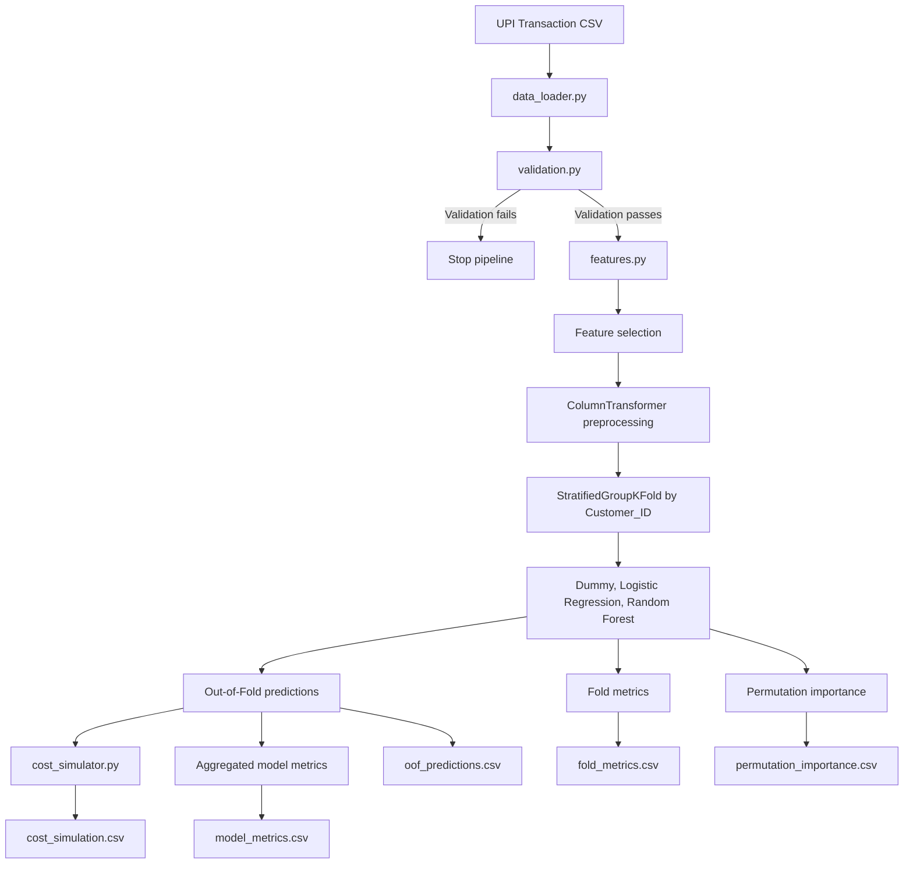

# Technical Architecture

## 1. Project Overview

This project evaluates fraud-risk classification using a 100,000-row synthetic UPI transaction dataset. The workflow includes data validation, feature engineering, grouped cross-validation, model evaluation, business-cost simulation, exploratory analysis, and SQL investigations.

## 2. End-to-End Machine Learning Pipeline

## 3. Supporting Analytical Workflows

### Exploratory Data Analysis

- `scripts/eda_analysis.py` generates descriptive summaries and statistical tests.
- Results are saved under `outputs/`.
- Effect sizes are considered alongside p-values.

### SQL Investigations

- `sql/01_velocity.sql` examines time gaps between consecutive transactions for each customer.
- `sql/02_device_concentration.sql` examines device and IP address reuse.
- These are descriptive investigations, not proof of fraud or causal relationships.

## 4. Model Evaluation Design

- Five-fold `StratifiedGroupKFold` cross-validation.
- `Customer_ID` is the grouping variable, not a model predictor.
- Each transaction receives an out-of-fold prediction from a model that did not train on that transaction.
- Logistic Regression and Random Forest are compared against a Dummy Classifier.
- Random Forest permutation importance is calculated on held-out folds.

## 5. Business Cost Simulation

The cost simulator evaluates threshold-based decisions using out-of-fold probabilities.

Illustrative assumptions:

- Investigation cost: ₹20 per flagged transaction.
- Missed-fraud cost: ₹500 per missed fraudulent transaction.

Formula:

`Total_Cost = (Flagged ₹ Investigation_Cost) + (False_Negatives ₹ Missed_Fraud_Cost)`

These are scenario assumptions, not measured bank losses. The generated `outputs/cost_simulation.csv` uses the field `Total_Cost`.

## 6. Important Limitations

- The dataset is synthetic and does not establish real-world UPI fraud performance.
- Three historical features with unverified provenance are excluded from the model.
- Near-chance model discrimination must be reported honestly.
- The evaluation reduces known leakage risks but does not prove that every possible source of leakage has been eliminated.
